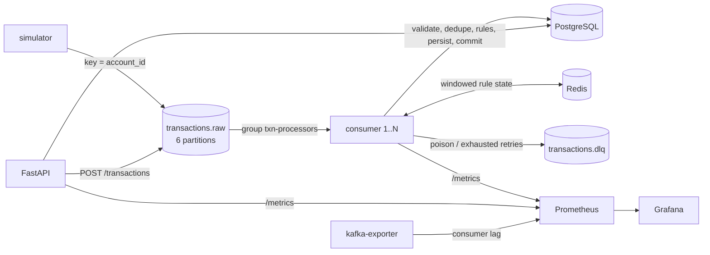

# Real-Time Transaction Anomaly Pipeline


An event-driven pipeline that ingests simulated payment transactions from **Kafka**, evaluates them
against fraud-style rules (velocity, amount spike, impossible travel), stores the results in
**PostgreSQL**, and exposes them through a **FastAPI** REST API, with **Prometheus/Grafana**
observability. It is built to demonstrate partitioning and keying, idempotent consumers, retries with
backoff, a dead-letter queue, graceful shutdown, and measured performance work.



## Quick start

Requirements: Docker with Compose v2. Nothing else (no cloud account, no secrets).

```bash
cp .env.example .env
docker compose up -d --build      # kafka, postgres, redis, migrations, consumer, api, prometheus, grafana
make load                         # 60 s of traffic at 500 msg/s with injected fraud (or see below)
```

| What | URL |
|---|---|
| API docs (OpenAPI) | http://localhost:8000/docs |
| Alerts | http://localhost:8000/alerts |
| Stats | http://localhost:8000/stats |
| Grafana dashboard (anonymous viewer) | http://localhost:3000 |
| Prometheus | http://localhost:9090 |

Without `make`:

```bash
docker compose --profile load run --rm simulator --rate 500 --duration 60 --accounts 2000 --fraud-ratio 0.02 --seed 42
docker compose --profile load run --rm simulator --count 50 --invalid-ratio 0.2   # exercise the DLQ
```

Try one by hand:

```bash
curl -X POST localhost:8000/transactions -H 'content-type: application/json' -d '{
  "transaction_id":"7b1f4a52-9a1e-4b6a-8e53-2f2d1c9a0a11","account_id":"acc_0042","merchant_id":"m_981",
  "amount":"129.99","currency":"USD","country":"IN","channel":"online","timestamp":"2026-10-15T10:21:33Z"}'
curl localhost:8000/transactions/7b1f4a52-9a1e-4b6a-8e53-2f2d1c9a0a11
```

## Features

* **Kafka** (KRaft, 6 partitions, key = `account_id`), manual offset commits after the DB commit,
  cooperative-sticky rebalancing with callbacks, clean shutdown on SIGTERM/SIGINT.
* **Idempotent processing:** `INSERT ... ON CONFLICT DO NOTHING` on `transaction_id` and on
  `(transaction_id, rule)`; redelivered messages are detected and skipped.
* **Retries and DLQ:** exponential backoff with full jitter for transient errors only; invalid
  messages go straight to `transactions.dlq` with diagnostic headers; `scripts/replay_dlq.py`.
* **Rules:** `VELOCITY`, `AMOUNT_SPIKE`, `GEO_MISMATCH` as pure functions over per-account state in Redis.
* **Batching** (`BATCH_SIZE`): one DB transaction and one offset commit per batch, with an in-memory
  state overlay so rules stay correct inside a batch.
* **REST API:** keyset pagination, consistent error bodies, `/health`, `/ready`, `/metrics`.
* **Observability:** per-service metrics, consumer lag via kafka-exporter, provisioned Grafana dashboard
  (throughput, alerts, lag per partition, latency p50/p95/p99, retries and DLQ, API rate and latency).
* **Engineering hygiene:** type hints, ruff, mypy, unit and testcontainers integration tests, CI,
  one multi-stage non-root Docker image.

Stack: Python 3.11, confluent-kafka, FastAPI, Pydantic v2, SQLAlchemy 2 + psycopg 3, Alembic, Redis 7,
PostgreSQL 16, Kafka 3.7, Prometheus, Grafana.

## Operations

```bash
make scale n=3          # run 3 consumers in the same group (max useful = 6 partitions)
make replay-dlq         # republish up to 100 DLQ messages to the raw topic
docker compose run --rm --entrypoint python consumer scripts/replay_dlq.py --dry-run --error-type validation
docker compose stop consumer   # SIGTERM: finishes the batch, commits, leaves the group
```

All settings are environment variables with defaults in `.env.example` (`BATCH_SIZE`, thresholds,
retry parameters, ...).

## Tests

```bash
pip install -e ".[dev]"
make lint            # ruff check + format check + mypy
pytest tests/unit    # no external services
make test            # unit + integration (needs Docker for testcontainers), 80% coverage gate
```

Integration tests start real Kafka, PostgreSQL and Redis containers and cover: end-to-end alerts,
idempotency (same `transaction_id` twice), DLQ headers, crash before offset commit and redelivery,
state surviving a consumer restart, and the API (filters, cursors, 404s).

## Benchmarks

Measured with `scripts/benchmark.py` on a 14-CPU Windows 11 laptop running everything (Kafka, Postgres,
Redis, consumers, monitoring) in one Docker VM; median of 3 runs, 200,000 pre-loaded messages
(experiment A: 20,000). Throughput is the time the consumers needed to drain the backlog.

| Experiment | Consumers | Batch size | Throughput (msg/s) | vs baseline |
|---|---|---|---|---|
| A baseline | 1 | 1 | 86 | 1x |
| B batching | 1 | 200 | 972 | 11.3x |
| C | 3 | 200 | 1,618 | 18.8x |
| D | 6 | 200 | 1,980 | 23.0x |
| E (8 consumers > 6 partitions) | 8 | 200 | 2,112 | 24.6x (within noise of D; 2 consumers idle) |

Batching gave the largest gain; scaling out is sub-linear, and PostgreSQL (plus the shared VM) is the
likely limit. Run-to-run noise is high. Method, per-run values, CPU usage and caveats:
[docs/BENCHMARKS.md](docs/BENCHMARKS.md).

## Design

See [docs/DESIGN.md](docs/DESIGN.md) for the decisions and the answers to the usual interview
questions (keying, delivery guarantees, crash and rebalance behaviour, DLQ, hot keys, schema evolution,
exactly-once, 100x scale).

## Limitations and future work

* No authentication or authorization on the API (explicitly out of scope).
* JSON payloads; a schema registry with Avro/Protobuf would be the next step.
* At-least-once with an idempotent sink, not exactly-once; Redis rule state is updated after the DB
  commit, so a crash in between can drop one batch from the windows.
* Strict out-of-order event handling is not implemented (event time is used; stale events are ignored
  by the velocity rule).
* A batch that exhausts transient retries goes to the DLQ as a whole; a circuit breaker that pauses
  consumption would be better for long outages.
* Single-broker Kafka, single Postgres and Redis (demo topology); Kubernetes manifests and the optional
  `/ui` page are not included.
* Grafana screenshot: not captured yet; run `make load` and open http://localhost:3000.
